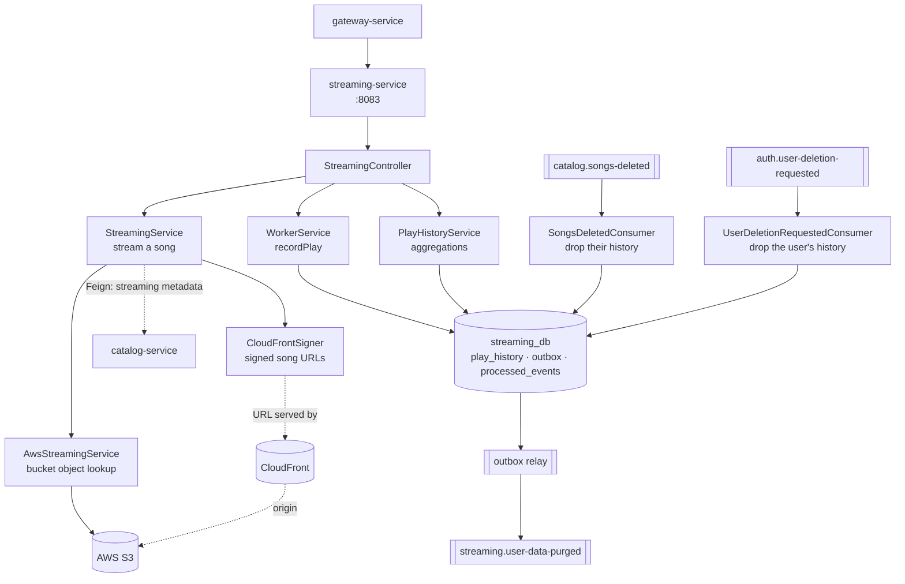
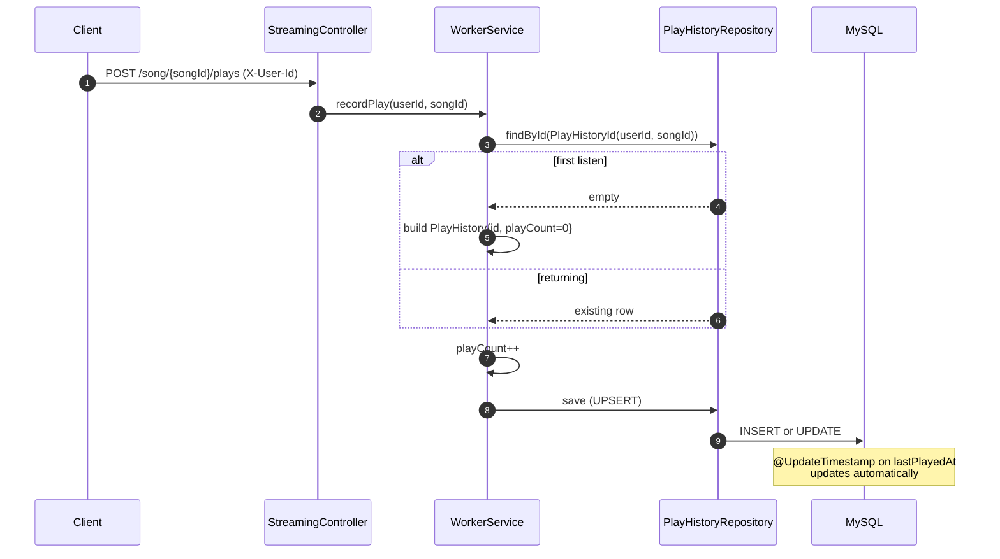
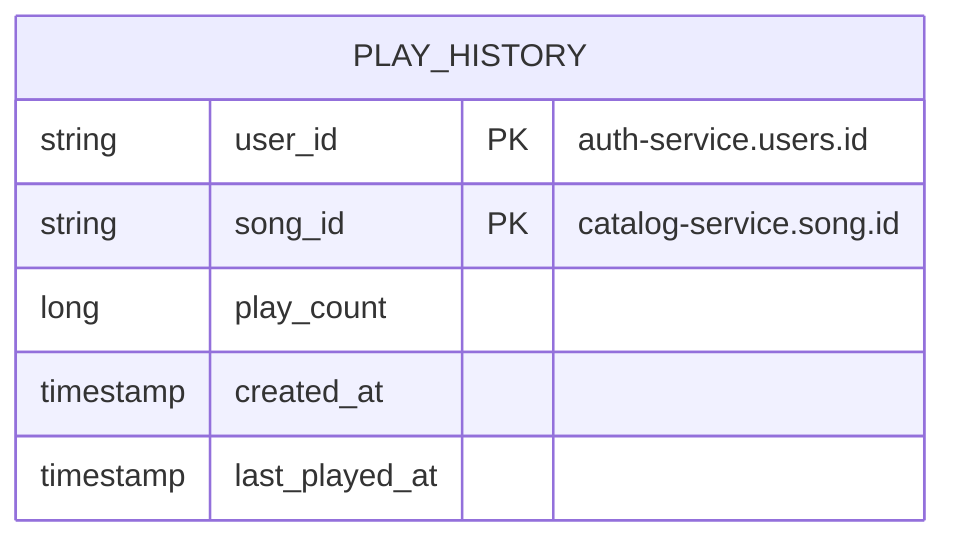

# streaming-service

Aggregates play history. Records what the user has been playing, exposes per-user history + top songs, and computes platform-wide stats (trending songs, total plays, unique listeners). Also serves the audio stream itself (S3 signed URLs).

## Responsibilities

- Record a play (called by the audio player after a song crosses the play threshold)
- Per-user reads: recent listening history, top songs by play count
- Platform reads: trending songs (windowed or all-time), total plays per song, unique-listener counts
- Audio streaming endpoint that returns an S3 signed URL for the requested song

## Architecture



`WorkerService.recordPlay` is the only write path; everything else is read-side aggregation.

## Streaming a Song

streaming-service never relays audio bytes. `GET /song/{songId}` looks the song's `song_url` up in catalog-service and
returns where the client should play it from, as `ApiResponseDTO<{ url, expiresAt }>`:

| `song_url` | Response |
|---|---|
| An object URL in our bucket, object present | CloudFront signed URL for the same key, valid for 1 hour (`StreamingService.URL_TTL`) |
| An object URL in our bucket, object missing (upload never finished) | 404 |
| Any other host (e.g. seeded tracks) | `song_url` unchanged, `expiresAt` null |
| Unknown song / no `song_url` | 404 |

The call records nothing, so the player can fetch the next song's URL ahead of time and preload it; it records the
play with `POST /song/{songId}/plays` once playback starts. The browser uses the URL as an `<audio>` `src` and makes its own range
requests against CloudFront, so seeking and buffering don't come back through the gateway, and popular songs are served
from edge caches instead of S3.

`CloudFrontSigner` signs with a canned policy (expiry only). The distribution must be set up to match:

- Origin: the bucket, through Origin Access Control, so the bucket stays private and only CloudFront can read it
- Restrict viewer access with a trusted key group holding the public key of `cloud.aws.cloudfront.key-pair-id`
- Cache policy without query strings in the cache key, so every listener's differently-signed URL hits the same cached
  object

## Recording a Play



Find-or-create + increment is intentionally simple — there's one row per `(user, song)` and `playCount` is the source of truth. Trending and stats queries derive from this.

## Read-Side Aggregations

`PlayHistoryService` is mostly thin wrappers around JPQL projection queries:

| Method | Backing query | Notes |
|---|---|---|
| `getRecentHistory` | `WHERE user_id = ? ORDER BY last_played_at DESC` | Per-user recency |
| `getUserTopSongs` | `WHERE user_id = ? ORDER BY play_count DESC` | Per-user top |
| `getTrendingSongs` | `SELECT song_id, SUM(play_count) GROUP BY song_id ORDER BY SUM DESC` | Platform-wide |
| `getTrendingSongsSince(Instant)` | Same + `WHERE last_played_at >= ?` | Time-windowed |
| `getSongStats(songId)` | `SUM(play_count)` + `COUNT(DISTINCT user_id)` | Total plays + unique listeners |
| `getSongPlayCounts(List<songId>)` | Aggregate over a song list | Bulk |
| `getUniqueListeners(List<songId>, Instant)` | `COUNT(DISTINCT user_id)` with optional time floor | |

The `SongPlayCountProjection` interface is a Spring Data interface projection (just `getSongId()` / `getPlayCount()`) — no DTO mapping in service code.

## REST API

All routes under `/api/v1/stream` and reachable through the gateway.

| Method | Path | Auth | Purpose |
|---|---|---|---|
| GET | `/song/{songId}` | user | The URL to play the song from (CloudFront signed URL, 1 h); records nothing |
| POST | `/song/{songId}/plays` | user | Records one play for `X-User-Id`; the player calls it when playback starts |
| GET | `/history` | user | Recent play history for `X-User-Id` |
| GET | `/stats/users/me/top-songs` | user | Top songs for `X-User-Id` |
| GET | `/stats/trending?since=&page=&size=` | public | Platform-wide trending; `since` filters by Instant |
| GET | `/stats/songs/{songId}` | public | `{ totalPlays, totalListeners }` |
| GET | `/stats/songs/play-counts?songIds=...` | public | Play counts for a list of songs (bulk) |
| GET | `/stats/listeners?songIds=...&since=` | public | Unique listener count across a song list |

## Persistence Model



Single table, composite `@EmbeddedId` of `(user_id, song_id)`. Indexes:

- `(user_id, song_id)` — primary lookup for `recordPlay`
- `(song_id)` — reverse lookup for per-song stats
- `(user_id, play_count DESC)` — for `getUserTopSongs`
- `(user_id, last_played_at DESC)` — for `getRecentHistory`
- `(song_id, last_played_at)` — for time-windowed trending

`@CreationTimestamp` and `@UpdateTimestamp` keep the audit fields in sync without explicit setters.

## Eventing

Plays are recorded synchronously via HTTP — there's no benefit to going async because the call is on the critical
path of the audio player anyway.

| Direction | Topic | Handler | Effect |
|---|---|---|---|
| Consumes | `catalog.songs-deleted` | `SongsDeletedConsumer` | Deletes `play_history` rows of songs catalog-service deleted, so they stop taking trending / top-song slots |

Consumption goes through cadence-messaging (envelope decoding, idempotent `processed_events`, retries then DLT).

## Cross-Cutting Concerns

- **Outbound Feign call** to `CatalogClient.getStreamingMetadata` goes through `FeignClientConfig.gatewaySecretInterceptor` which stamps `X-Gateway-Secret` on every request. Required for catalog-service's `InternalTrafficFilter` to accept the call.
- **Resilience4j circuit breaker** wraps `CatalogClient`. `CatalogClientFallback` returns null on catalog outage — `getStreamUrl` already maps null metadata to 404, so the user sees "song not found" instead of a 500 / hang.
- **`/actuator/refresh` rebinds `gateway.secret`** via `GatewaySecretProperties` for hot rotation without a restart.

## Configuration

Local `application.properties`:

```properties
spring.application.name=streaming-service
server.port=8083
spring.config.import=optional:file:../env.properties,optional:configserver:http://localhost:8888
```

From `centralconfigs/streaming-service/streaming-service.properties`:

- `spring.datasource.*` — MySQL
- `spring.jpa.hibernate.ddl-auto=update`
- `cloud.aws.credentials.*`, `cloud.aws.region.static`, `cloud.aws.s3.bucket` — to check a song's object exists
- `cloud.aws.cloudfront.domain`, `cloud.aws.cloudfront.key-pair-id`, `cloud.aws.cloudfront.private-key-path` — for signed URL generation; the service doesn't start without a readable, valid key file. Put the key at `secrets/cloudfront_private_key.pem` (gitignored): compose mounts it into the container at `/run/secrets/cloudfront_private_key.pem` and points the path there

## Testing

| Test | What it covers |
|---|---|
| `WorkerServiceTest` | Find-or-create + increment with mocked repository |
| `PlayHistoryServiceTest` | Aggregation methods over mocked repository projections |
| `StreamingControllerTest` | `@WebMvcTest` slice — HTTP wiring + header validation |
| `AwsStreamingServiceTest` | Bucket-URL detection with a mocked `AmazonS3` |
| `CloudFrontSignerTest` | Signed URL shape, signature verified against the canned policy, key file loading, PKCS#1/PKCS#8 parsing |
| `StreamingServiceIT` | Signed vs external vs missing-upload resolution; fetching a URL records no play |
| `InternalTrafficFilterTest` | Gateway-secret enforcement |
| `PlayHistoryIT` | Real MySQL — covers `@EmbeddedId` upsert, `lastPlayedAt` auto-update, JPQL aggregations (`SUM`/`GROUP BY`/`COUNT(DISTINCT)`), time-windowed filters with real `Instant` boundaries |

The integration tests use a real MySQL container so the `SUM`/`GROUP BY`/`COUNT(DISTINCT)` JPQL queries get exercised against a real query planner — mocks would never have caught a JPQL syntax mistake.

```bash
cd streaming-service && ./mvnw test
```

## Local Development

```bash
cd streaming-service
./mvnw spring-boot:run
```

Required env:

- `DATASOURCE_*`
- `AWS_ACCESS_KEY`, `AWS_SECRET_KEY`, `AWS_REGION`, `AWS_S3_BUCKET`
- `AWS_CLOUDFRONT_DOMAIN`, `AWS_CLOUDFRONT_KEY_PAIR_ID`, `AWS_CLOUDFRONT_PRIVATE_KEY_PATH` (the key file's path on your machine)

## Boot Order

discovery-service → config-server → streaming-service. Starts without any other backend service. At runtime, streaming a song calls catalog-service over Feign for its metadata; user and song ids in `play_history` are references by id only (no cross-schema foreign keys), cleaned up by the song-deletion and account-deletion sagas.

**Account deletion:** consumes `auth.user-deletion-requested`, deletes the user's play history, and confirms with `streaming.user-data-purged` in the same transaction (idempotent).
